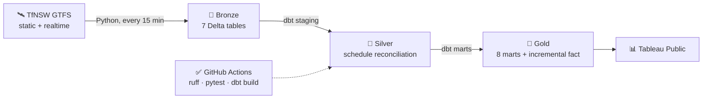
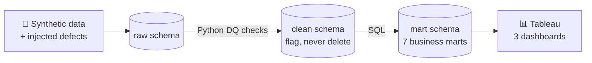

 

## 👋 About me

I'm a data engineer in Sydney with a **Master of Data Science from Macquarie University**. I like the unglamorous part of data work: getting raw data in reliably, testing it, reconciling it against the source, and only then putting it on a dashboard.

At **Optus** I worked part-time in data operations, keeping production **Databricks** and **dbt** pipelines healthy, chasing failed loads and reconciling tables in **SQL** with senior data engineers.

I now do on-site IT operations support at **Total IT Global** for enterprise clients and their developer and data teams.

- 🎯 **Looking for:** junior data engineering, analytics engineering, data analyst and BI roles
- 🧪 **Strength:** data quality, reconciliation and pipeline testing
- 🏗️ **Favourite stack:** SQL, dbt and Databricks, with CI on GitHub Actions
- 💬 **Ask me about:** medallion lakehouses, dbt tests, and why a pandas `groupby` can quietly lose $185K

## 💼 Experience

| Role | Where | When | What I did |
|---|---|---|---|
| 🖥️ **IT Operations Support Technician** | Total IT Global | Oct 2026 to now | On-site support for AMD, Zimmer Biomet, HCL and Corteva. Tickets, laptops and onboarding, Active Directory and Entra ID, licences and inventory |
| 📡 **Junior Data Operations Engineer** *(part-time)* | Optus | Jun 2025 to Aug 2026 | Monitored Databricks and dbt pipelines, investigated failed loads, reconciled source and destination tables in SQL, automated checks in Python, logged incidents in Jira and ServiceNow |

## 🧰 Tech stack

  

 

 

## 🚀 Featured projects

### 🚆 Sydney Transit Intelligence Platform

<table>
<tr>
<td width="42%" valign="top">

</td>
<td width="58%" valign="top">

*Finding the signal in every delay.* Live Transport for NSW rail data, captured every 15 minutes and reconciled against the timetable.

- 🔎 T8, T2, T4 and T1 cause 54% of delay-minutes across 57,363 reconciled stop events
- 🌆 The evening peak runs 87-88% on time against 97-99% in the morning
- 🏗️ Bronze/Silver/Gold on Databricks, dbt Core with 8 marts and an incremental fact table
- 🛠️ Two silent pipeline failures found and fixed, then a health check so failures are loud

</td>
</tr>
</table>

<b>📈 See the findings charts</b>

 
<table>
<tr>
<td width="50%"></td>
<td width="50%"></td>
</tr>
</table>

 

### 💳 PayScope: Payments Risk & Merchant Analytics

<table>
<tr>
<td width="58%" valign="top">

*Payments · Risk · Insights.* A payments warehouse where defects are injected on purpose, so the data-quality layer can be graded against a known answer key.

- 🧪 Raw → clean → mart across 3 PostgreSQL schemas. Bad records are flagged, never deleted
- 🔎 Caught a validity cascade that wrongly excluded about 29,700 sound transactions
- 📊 7 SQL marts, explainable risk rules and 3 Tableau dashboards
- 💡 The source risk tier showed little link to real merchant behaviour, so merchants are segmented by behaviour instead

</td>
<td width="42%" valign="top">

</td>
</tr>
</table>

<b>📈 See the findings charts</b>

 
<table>
<tr>
<td width="50%"></td>
<td width="50%"></td>
</tr>
</table>

 

### 📦 E-Commerce Delivery & Retention Review

<table>
<tr>
<td width="42%" valign="top">

</td>
<td width="58%" valign="top">

*Is late delivery costing us customers?* 99K marketplace orders taken through Excel, Python, SQL and Power BI.

- ⭐ Orders 4+ days late score 1.85/5 against 4.29/5 for early ones
- 🗺️ Lateness clusters in a few states, up to 3.5x the national rate
- 🔁 Every pandas result reproduced in SQL, which caught 2 errors before the dashboard
- 📊 3-page Power BI dashboard with DAX measures checked against Python and SQL

</td>
</tr>
</table>

<b>📊 See the Power BI dashboards</b>

 
<table>
<tr>
<td width="50%"></td>
<td width="50%"></td>
</tr>
</table>

 

### 🔬 Machine learning & computer vision

<table>
<tr>
<td width="50%" valign="top" align="center">

  

**🏠 [Sydney Airbnb Guest Satisfaction](https://github.com/MSkandula/AirBNB)** 
17,730 listings · tuned XGBoost · ROC-AUC 0.771 · SHAP shows host portfolio size matters more than price

</td>
<td width="50%" valign="top" align="center">

  

**🫁 [Organ Disease Progression Visualizer](https://github.com/MSkandula/Disease-Progression-visuliazation)** 
CT-driven 3D lung visualizer · OpenCV features drive an auditable PyVista mesh · validated on 8 cases

  

**🔬 [Colorectal Cancer Tissue Classifier](https://github.com/MSkandula/Automatic-recognition-of-different-tissue-types-of-colorectal-cancer-using-deep-learning)** 
8 tissue types · custom CNN 94% vs VGG16 89% · TensorFlow, Keras

</td>
</tr>
</table>

## 🧭 How I work

<table>
<tr>
<td align="center" width="33%"><h3>🔁</h3><b>Reproduce every number twice</b> pandas against SQL, source against destination. If they disagree, the dashboard waits</td>
<td align="center" width="33%"><h3>🧪</h3><b>Test the pipeline, not just the code</b> dbt tests, health checks and CI, so failures are loud instead of silent</td>
<td align="center" width="33%"><h3>📝</h3><b>Write down the limits</b> Small samples, synthetic data and known gaps are stated up front in every repo</td>
</tr>
</table>

## 🎓 Education & certifications

<table>
<tr>
<td width="50%" valign="top">

**🎓 Master of Data Science** 
Macquarie University, Sydney · 2024-2026

**🎓 B.Tech, Computer Science & Engineering** 
GITAM University, India · 2020-2024

</td>
<td width="50%" valign="top">

 
 

</td>
</tr>
</table>

### 🤝 Let's connect

