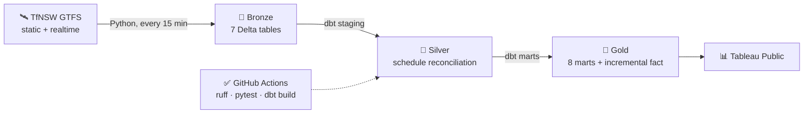
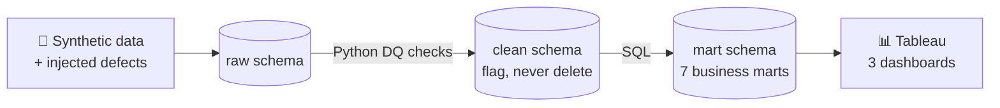

 

---

## 👋 About me

I'm a data engineer in Sydney with a **Master of Data Science from Macquarie University**. I like the unglamorous part of data work: getting raw data in reliably, testing it, reconciling it against the source, and only then putting it on a dashboard.

At **Optus** I worked part-time in data operations, keeping production **Databricks** and **dbt** pipelines healthy, chasing failed loads and reconciling tables in **SQL** with senior data engineers. I now do on-site IT operations support at **Total IT Global** for enterprise clients and their developer and data teams.

<table>
<tr>
<td align="center" width="25%"><h3>🎯</h3><b>Looking for</b> Junior data engineering, analytics engineering, data analyst and BI roles</td>
<td align="center" width="25%"><h3>🧪</h3><b>Strength</b> Data quality, reconciliation and pipeline testing</td>
<td align="center" width="25%"><h3>🏗️</h3><b>Favourite stack</b> SQL, dbt and Databricks, with CI on GitHub Actions</td>
<td align="center" width="25%"><h3>📍</h3><b>Location</b> Sydney, Australia</td>
</tr>
</table>

---

## 💼 Experience

| Role | Where | When | What I did |
|---|---|---|---|
| **IT Operations Support Technician** | Total IT Global | Oct 2026 to now | On-site support for AMD, Zimmer Biomet, HCL and Corteva. Tickets, laptops and onboarding, Active Directory and Entra ID, licences and inventory |
| **Junior Data Operations Engineer** *(part-time)* | Optus | Jun 2025 to Aug 2026 | Monitored Databricks and dbt pipelines, investigated failed loads, reconciled source and destination tables in SQL, automated checks in Python, logged incidents in Jira and ServiceNow |

---

## 🧰 Tech stack

<table>
<tr><td><b>Languages</b></td><td>

</td></tr>
<tr><td><b>Data engineering</b></td><td>

</td></tr>
<tr><td><b>BI & reporting</b></td><td>

</td></tr>
<tr><td><b>Testing & CI</b></td><td>

</td></tr>
<tr><td><b>ML & tools</b></td><td>

</td></tr>
</table>

---

## 🚀 Featured projects

### 🚆 Sydney Transit Intelligence Platform

> Live Transport for NSW rail data, captured every 15 minutes, reconciled against the timetable and turned into reliability insight.
> &nbsp;[**View repo →**](https://github.com/MSkandula/sydney-transit-intelligence-platform)

  
  
  

<table>
<tr>
<td width="50%"></td>
<td width="50%"></td>
</tr>
</table>

- **What it found:** across 57,363 reconciled stop events, T8, T2, T4 and T1 cause 54% of delay-minutes, and the evening peak (5-7pm) runs 87-88% on time against 97-99% in the morning
- **How it's built:** Bronze/Silver/Gold lakehouse on Databricks, dbt Core models with 31 tests, CI against an isolated schema on every PR, dbt docs on GitHub Pages
- **What went wrong and got fixed:** two silent pipeline failures, found, fixed and written up in the runbook, then a health check so every run ends `done OK` or `done FAILED`

---

### 💳 PayScope: Payments Risk & Merchant Analytics

> A payments data warehouse where defects are injected on purpose, so the data-quality layer can be graded against a known answer key.
> &nbsp;[**View repo →**](https://github.com/MSkandula/PAYscope) · [**Live dashboards →**](https://public.tableau.com/app/profile/mahesh.sai.kandula7753/viz/Transaction_monitoring/Dashboard3?publish=yes)

  
  
  

<table>
<tr>
<td width="50%"></td>
<td width="50%"></td>
</tr>
</table>

- **What it found:** a validity cascade that wrongly excluded about 29,700 sound transactions because of cosmetic issues upstream, and a source risk tier with little link to how merchants actually behave
- **How it's built:** raw, clean and mart schemas in PostgreSQL, a Python data-quality framework, 7 SQL marts, an explainable rule-based risk engine and 3 Tableau dashboards
- **Why it matters:** most portfolio dashboards start from a clean CSV. This one shows the messy part before the chart

---

### 📦 E-Commerce Delivery & Retention Review

> 99K marketplace orders taken through Excel, Python, SQL and Power BI, with every number reproduced twice.
> &nbsp;[**View repo →**](https://github.com/MSkandula/ecommerce-delivery-retention-review)

  
  
  

<table>
<tr>
<td width="50%"></td>
<td width="50%"></td>
</tr>
</table>

- **What it found:** orders 4+ days late score 1.85/5 against 4.29/5 for early ones, lateness clusters in a few states (up to 3.5x the national rate), and only 3.12% of customers order again
- **How it's built:** 9 tables loaded into PostgreSQL, analysis in pandas and SQL, a 3-page Power BI dashboard with DAX measures checked against both
- **Self-caught errors:** a pandas `groupby` silently dropping $185K of revenue, and a naive freight ratio. Both were caught by the SQL reproduction before reaching the dashboard

---

<b>🔬 More projects: machine learning and computer vision</b>

 

| Project | What it does | Stack |
|---|---|---|
| 🏠 [Sydney Airbnb Guest Satisfaction](https://github.com/MSkandula/AirBNB) | Predicts top-tier listings from 17,730 Sydney records. Tuned XGBoost reaches ROC-AUC 0.771, and SHAP shows host portfolio size matters more than price or amenities | Python, scikit-learn, XGBoost, SHAP |
| 🫁 [Organ Disease Progression Visualizer](https://github.com/MSkandula/Disease-Progression-visuliazation) | CT-driven 3D lung-disease visualizer. OpenCV features drive an auditable PyVista mesh, validated on 8 cases | Python, OpenCV, PyVista |
| 🔬 [Colorectal Cancer Tissue Classifier](https://github.com/MSkandula/Automatic-recognition-of-different-tissue-types-of-colorectal-cancer-using-deep-learning) | Classifies histopathology images into 8 tissue types. A custom CNN (94%) beat VGG16 transfer learning (89%) | TensorFlow, Keras |

---

## 🧭 How I work

<table>
<tr>
<td align="center" width="33%"><h3>🔁</h3><b>Reproduce every number twice</b> pandas against SQL, source against destination. If they disagree, the dashboard waits</td>
<td align="center" width="33%"><h3>🧪</h3><b>Test the pipeline, not just the code</b> dbt tests, health checks and CI, so failures are loud instead of silent</td>
<td align="center" width="33%"><h3>📝</h3><b>Write down the limits</b> Small samples, synthetic data and known gaps are stated up front in every repo</td>
</tr>
</table>

---

## 🎓 Education & certifications

<table>
<tr>
<td width="50%" valign="top">

**🎓 Master of Data Science** 
Macquarie University, Sydney · 2024-2026

**🎓 B.Tech, Computer Science & Engineering** 
GITAM University, India · 2020-2024

</td>
<td width="50%" valign="top">

 
 

</td>
</tr>
</table>

---

### 🤝 Let's connect

I'm open to junior data engineering, analytics engineering, data analyst and BI roles in Sydney. 
The fastest way to reach me is [LinkedIn](https://www.linkedin.com/in/mahesh-kandula-data/) or [email](mailto:maheshsaikandula@gmail.com).

